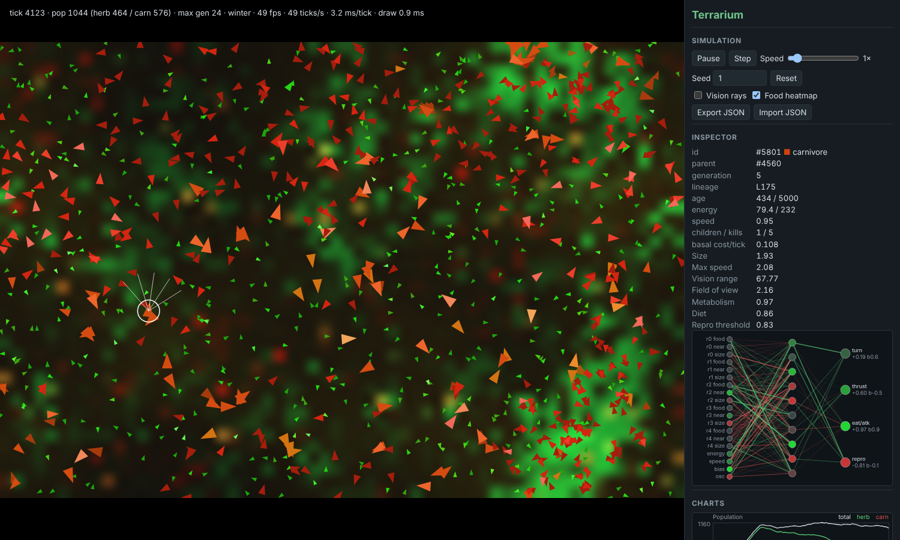

# Terrarium

A browser-based artificial-life simulation. Small creatures with neural-network brains wander a
wrapping 2D world, graze plants, hunt each other, reproduce with mutation and die. There is **no
fitness function**: whatever behaviour gathers energy faster than it burns it leaves more
offspring, and that is all evolution needs.



## Run it

```bash
npm install
npm run dev        # open the printed URL (http://localhost:5173)
npm test           # unit + integration tests (Vitest)
npm run build      # type-check (tsc) + production build into dist/
```

Headless tools (plain Node ≥ 22.18, no browser):

```bash
npm run headless -- --ticks 50000 --seed 3 --every 2500     # one run, prints a table
npm run tune -- --ticks 50000 --seeds 1,2,3,4,5             # several seeds in parallel, verdict per seed
npm run tune -- --seeds 1,2 --config '{"foodMax":40}'       # try a parameter change
npm run bench                                               # throughput numbers
npm run e2e                                                 # browser smoke test → docs/screenshot.png
```

## Using the app

* **Play/Pause** (Space), **Step** (S), **Speed** 1×–50× ticks per frame (capped by a 14 ms budget
  so the page never freezes).
* **Seed + Reset**: same seed ⇒ the exact same history. Text seeds are hashed.
* **Vision rays** draws every creature's 5 rays; **Food heatmap** toggles the plant layer
  (green = plants, brown tint = fertile soil, red stain = carrion).
* **Click a creature** to inspect it: id, parent, generation, lineage, age, energy, traits, kills,
  and a live diagram of its brain (node colour = activation, green/red edges = positive/negative
  weights, only strong ones drawn).
* **Charts**: population (total / herbivores / carnivores), herbivore–carnivore share, mean of
  every trait (normalised to its range) and max generation.
* **Event log**: first carnivore born, population crashes, new dominant lineage, extinctions.
* **Export / Import JSON**: the full world state; a loaded world continues bit-for-bit.

## How it works

* **World** — 1200×800 units, wrapping on both axes. Plants live on a 60×40 grid; each cell regrows
  logistically toward a capacity set by a static **fertility** map (seeded noise → oases and
  deserts). A sine **season** scales regrowth (lush summers, lean winters).
* **Creatures** — position, heading, speed, energy, age and a genome: the weights of a
  19 → 10 (tanh) → 4 (tanh) network plus 7 body traits: size, max speed, vision range, field of
  view, metabolism, diet (0 herbivore … 1 carnivore) and reproduction threshold.
* **Senses** — 5 rays across the field of view, each reporting the food level along it (food *this*
  creature can digest), the closeness of the nearest creature in that wedge and its relative size;
  plus own energy, own speed, a bias and a slow oscillator.
* **Actions** — turn, thrust, eat/attack intent, reproduce intent.
* **Energy** — basal cost (size × metabolism × brain/vision/speed surcharges) + movement cost
  (size × speed²). Plants yield `(1 − diet)²`, meat `diet²`: specialists beat generalists. Attacks
  hit the nearest creature in a front cone within reach; damage grows with size and size ratio.
  Kills let the predator feast; corpses fertilise the soil and leave **carrion** that only
  meat-eaters can digest.
* **Reproduction** — asexual: above its energy threshold and with the reproduce output positive, a
  creature pays half its energy for one child whose genome is the parent's plus Gaussian mutations
  (rarely a large jump, which also founds a new lineage).
* **Death** — energy ≤ 0 or old age.

Code layout and the per-tick pipeline are described in [ARCHITECTURE.md](ARCHITECTURE.md); every
parameter is in [`src/sim/config.ts`](src/sim/config.ts) with a one-line note;
[EXPLAINED.md](EXPLAINED.md) walks through each part in plain language;
[DECISIONS.md](DECISIONS.md) lists design choices; [PROGRESS.md](PROGRESS.md) has the tuning and
test evidence.

## Parameters that matter most

| Parameter | Effect |
|---|---|
| `foodMax`, `foodGrowthRate` | How rich the world is → overall population size. |
| `seasonAmplitude`, `seasonPeriod` | Strength/length of boom–bust cycles. |
| `fertilityContrast`, `fertilityMin` | How patchy the land is (oases vs. uniform plains). |
| `basalCost`, `moveCostCoef` | Cost of living and of moving; high values favour small, slow grazers. |
| `plantDietExponent`, `meatDietExponent` | Convexity of the diet trade-off; 1 = generalists viable. |
| `attackDamage`, `meatTransfer`, `killFeastFraction`, `attackCooldown` | How rewarding hunting is. |
| `carrionFraction`, `carrionDecay` | Scavenging buffer that keeps carnivores alive through prey troughs. |
| `reproCostFraction`, `reproEfficiency`, `minReproAge` | Cost and pace of breeding. |
| `mutationRate`, `weightMutationSigma`, `bigMutationChance` | Speed of evolution vs. stability. |
| `initialCarnivoreFraction` | 0 = carnivores must evolve from herbivores (rare). |

## What to look for

* **Seasonal booms and crashes**: population follows the season with a lag; crashes are logged.
* **Predator–prey cycles**: carnivore numbers rise after herbivores boom and fall after they crash.
* **Trait drift**: watch mean size fall (small bodies are cheap), vision range and field of view
  rise early on, and metabolism settle; carnivores tend to be larger than herbivores.
* **Behaviour**: grazers learn to keep the eat intent on and move along food gradients; turn on
  vision rays and inspect a carnivore to see "near"/"size" inputs drive its turn output.
* **Lineages**: large mutations found new lineages; occasionally one takes over (logged).

## Performance (measured)

| Scenario | Result |
|---|---|
| Default world, Node, 100,000 ticks (~500 creatures avg) | 120 s, ~830 ticks/s |
| 2,200 creatures, Node | 7.5 ms per tick |
| 2,200 creatures, headless Chromium | 7.7 ms sim + 2.9 ms draw per frame; 34 fps (container has no GPU) |
| ~1,000 creatures, headless Chromium at 1× | 49–56 fps, 2.3–3.2 ms sim + ~1 ms draw |

The HUD shows live fps, ticks/s, ms per tick and draw time. Details and what was tried are in
DECISIONS.md (#13).

## Determinism

`src/sim` is pure: no DOM, no `Math.random`, no clock (a test enforces this). All randomness
comes from one seeded mulberry32 generator, the timestep is fixed, iteration order is slot order,
and the free-slot list is LIFO. Same seed + config ⇒ byte-identical state (tested after 5,000
ticks, and save → load → continue equals an uninterrupted run).
